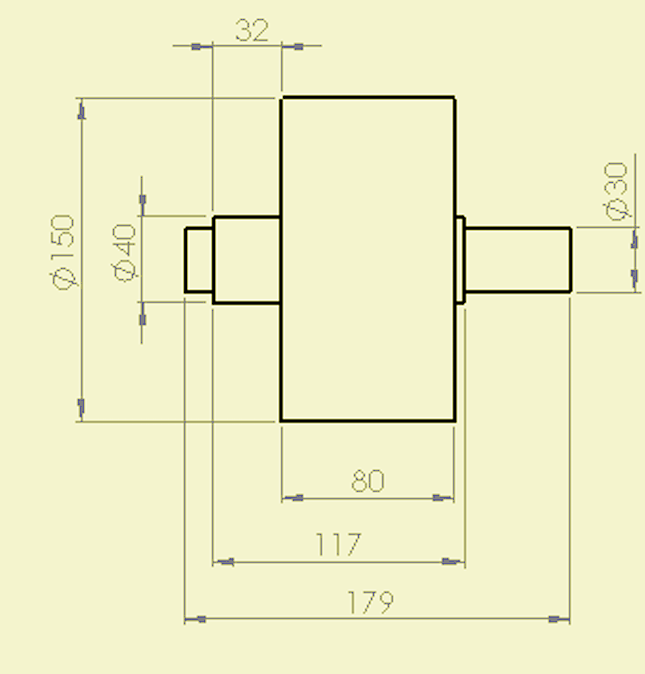
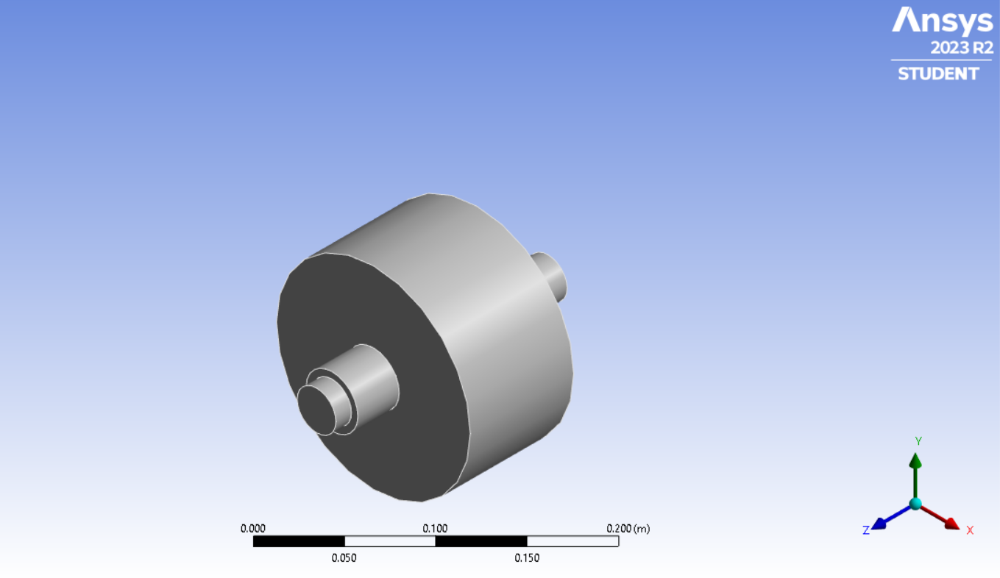
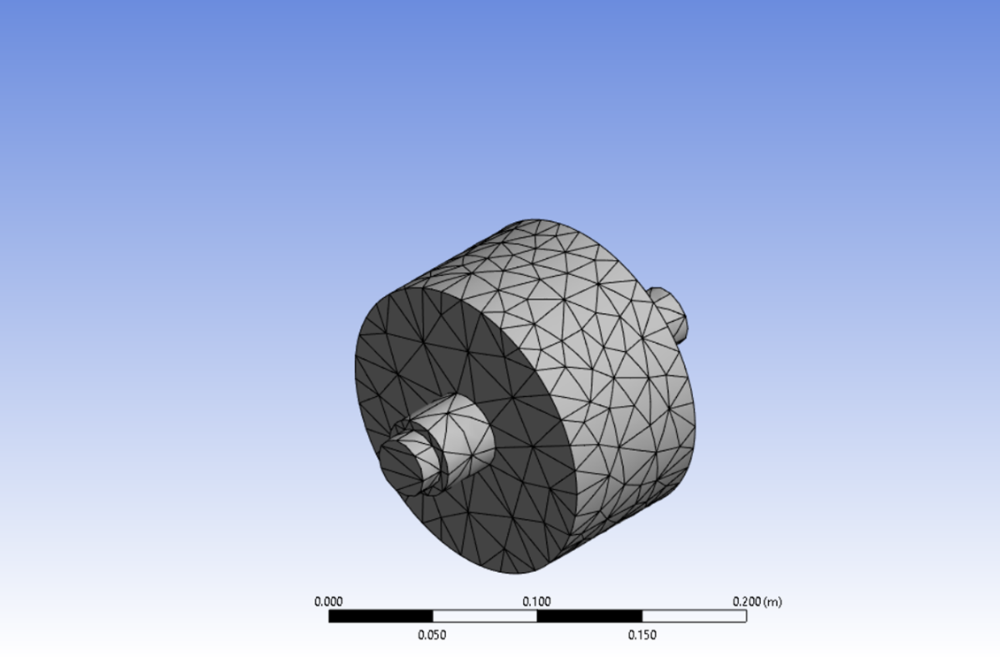
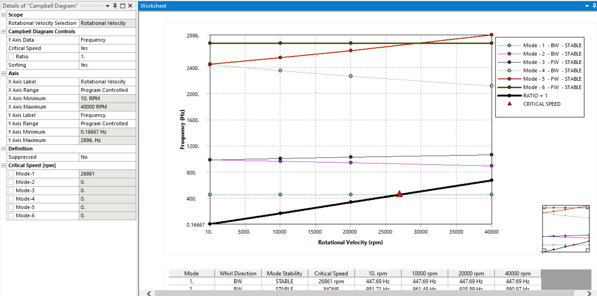
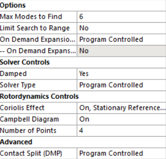
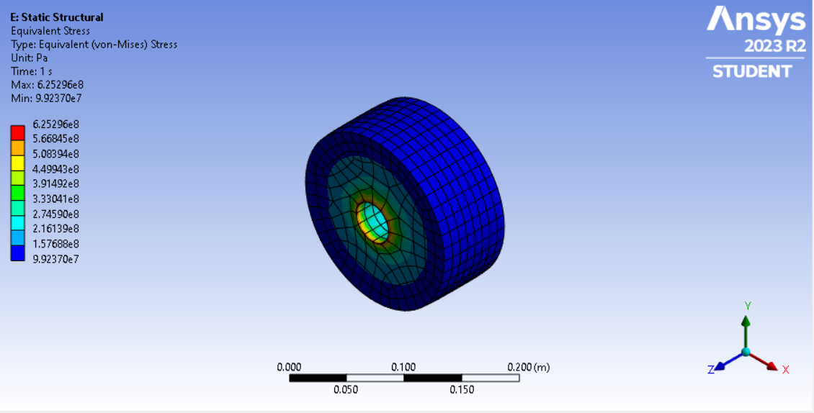

# Design Aspects & Rotordynamic FEA of High-Speed Rotors


**Author:** Wahid Eman Kalyan (Roll No. `002011201185`, B.E. Mechanical Engineering, Jadavpur University)  
**Faculty Advisor:** Dr. Sanjib Kumar Acharyya, Department of Mechanical Engineering, Jadavpur University  

---

## 📌 Executive Summary
High-speed electrical machines ($>10{,}000\text{ rpm}$, $>150\text{ m/s}$ surface speed) deliver superior power density and direct-drive efficiency for turbochargers, flywheels, and industrial compressors. However, operating near flexural critical speeds or under extreme centrifugal loads risks catastrophic rotordynamic instability and structural failure.

This project combines **rotordynamic theory** (SDOF, Rankine, Jeffcott, and Multi-DOF finite element formulations) with **3D Finite Element Analysis (ANSYS Workbench 2023 R2)** and **SolidWorks CAD modeling** to evaluate:
1. **Campbell Diagram & Critical Speed sensitivity** to bearing stiffness ($k = 1\text{ to }10^9\text{ N/m}$) and rotor outer radius ($r = 50\text{ to }150\text{ mm}$).
2. **Centrifugal Equivalent (von-Mises) Stress** across operating speeds ($10{,}000\text{ to }40{,}000\text{ rpm}$) and rotor radii against Structural Steel yield ($250\text{ MPa}$) and ultimate tensile strength ($460\text{ MPa}$) limits.

---

## 🛠️ Rotor Geometry & Material Specifications

| Parameter | Specification |
| :--- | :--- |
| **CAD & FEA Toolchain** | SolidWorks (3D & 2D Drafting), ANSYS Workbench 2023 R2 (Modal & Static Structural) |
| **Baseline Rotor Dimensions** | Disc Diameter: **Ø150 mm** · Disc Width: **80 mm** · Stepped Shaft: **Ø40 mm / Ø30 mm** · Total Length: **179 mm** |
| **Material** | Structural Steel ($
ho = 7850\text{ kg/m}^3$, $E = 200\text{ GPa}$, $\nu = 0.3$) |
| **Strength Limits** | Tensile Yield Strength: **250 MPa** · Tensile Ultimate Strength (UTS): **460 MPa** |
| **Rotordynamics Solver** | Damped Modal Analysis, Coriolis Effect **ON** (Stationary Reference Frame), Max Modes: **6** |

|  |  |  |

---

## 📊 Parametric FEA Results


### 1. Effect of Bearing Stiffness on 1st Critical Speed
Increasing bearing stiffness shifts the first flexural/rigid-body critical speed upward, creating a wider separation margin from the operating speed range ($18{,}000\text{ rpm}$ baseline):

| Bearing Stiffness $k$ (N/m) | 1st Critical Speed (rpm) | Engineering Takeaway |
| :---: | :---: | :--- |
| $1$ | $16{,}188$ | Below $18{,}000\text{ rpm}$ operating speed (unsafe margin) |
| $10^3$ | $16{,}188$ | Minimal change at low support stiffness |
| $10^5$ | $16{,}255$ | Still below $18{,}000\text{ rpm}$ target |
| $10^7$ | $21{,}648$ | Exceeds $18{,}000\text{ rpm}$ (~20% margin) |
| $10^9$ | $26{,}861$ | **Recommended ($+49\%$ margin above $18{,}000\text{ rpm}$)** |

### 2. Effect of Rotor Outer Radius on Critical Speed ($k = 10^9\text{ N/m}$)
| Outer Radius $r$ (mm) | 1st Critical Speed (rpm) |
| :---: | :---: |
| $50$ | $73{,}495$ |
| $75$ | $26{,}861$ |
| $100$ | $15{,}132$ |
| $125$ | $9{,}766.3$ |
| $150$ | $6{,}799$ |

### 3. Centrifugal Equivalent (von-Mises) Stress Analysis
| Rotational Speed (rpm) | Max von-Mises Stress (MPa) | Status vs. Structural Steel (250 MPa Yield / 460 MPa UTS) |
| :---: | :---: | :--- |
| $10{,}000$ | $39.08$ | Safe (well below Yield) |
| $18{,}000$ | $126.62$ | Safe (SF $\approx 1.97$ on Yield) |
| $20{,}000$ | $156.32$ | Safe (SF $\approx 1.60$ on Yield) |
| $30{,}000$ | $351.73$ | Exceeds Yield ($250\text{ MPa}$), below UTS ($460\text{ MPa}$) |
| $40{,}000$ | $625.30$ | **Structural Failure** (exceeds $460\text{ MPa}$ UTS) |

|  |  |  |

---

## 🧠 Key Engineering Conclusions
1. **Bearing Selection & Stiffness:** Deep-groove ball bearings with stiffness $\ge 10^7\text{–}10^9\text{ N/m}$ push the 1st critical speed to **$21{,}648\text{–}26{,}861\text{ rpm}$**, safely above an $18{,}000\text{ rpm}$ operating regime.
2. **Geometric Envelope:** Keeping the Structural Steel rotor outer radius **$r < 100\text{ mm}$** prevents both premature critical speed resonance and centrifugal over-stressing ($r = 125\text{ mm}$ reaches $493.97\text{ MPa} > 460\text{ MPa}$ UTS).
3. **Speed Ceiling & Material Upgrade:** For Structural Steel, rotational speed must stay **below $30{,}000\text{ rpm}$**; supercritical operation above $30{,}000\text{ rpm}$ requires higher-strength retaining sleeves (e.g., **Carbon-Fiber Composite**, **Titanium Alloys**, or **Inconel**).

---

## 📁 Repository Structure
```text
├── README.md                                  # Project documentation & FEA results
├──                                     # Extracted SolidWorks, ANSYS & Python plots
├── scripts/
│   └── rotordynamics_parametric_plots.py      # Reproducible Matplotlib summary script
└── docs/
    ├── High_Speed_Rotor_Presentation.pptx     # 38-slide project defense deck
    └── High_Speed_Rotor_Thesis_Report.docx    # Full undergraduate thesis report
```

---

## 📚 Selected References
1. C. Zwyssig, S. D. Round, and J. W. Kolar, *"Analytical and experimental investigation of a low torque, ultra-high speed drive system,"* Proc. IEEE Ind. Appl. Conf., 2006.
2. F. Zhou, J. X. Shen, W. Fei, and R. Lin, *"Study of retaining sleeve and conductive shield and their influence on rotor loss in high-speed PM BLDC motors,"* IEEE Trans. Magn., 2006.
3. A. Borisavljevic, H. Polinder, and J. A. Ferreira, *"On the speed limits of permanent-magnet machines,"* IEEE Trans. Ind. Electron., 2010.
4. G. Du, W. Xu, J. Zhu, and N. Huang, *"Rotor stress analysis for high-speed permanent magnet machines considering assembly gap and temperature gradient,"* IEEE Trans. Energy Convers., 2019.
